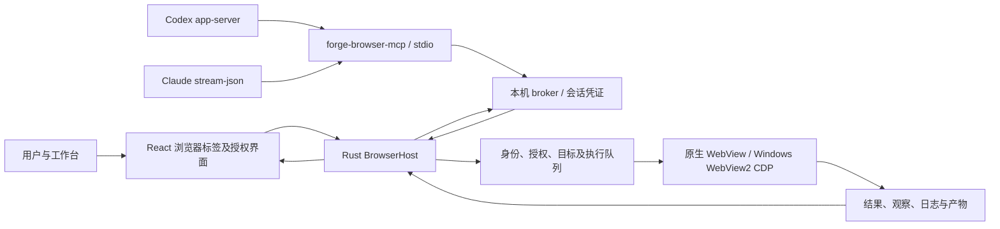
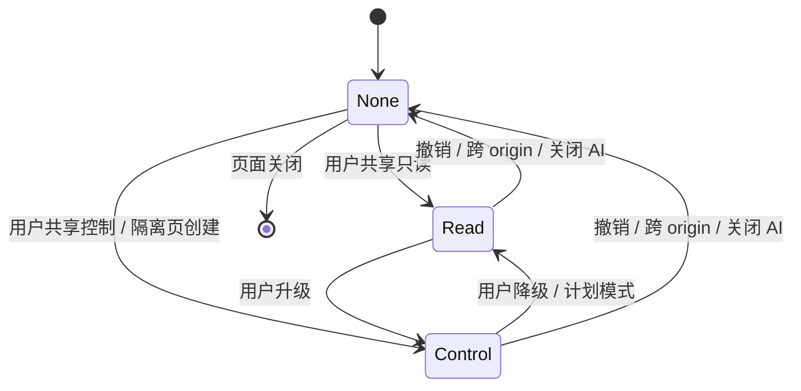

# Forge Browser Use 方案

**状态**：Windows 核心链路已实施；详细能力边界、三轮审查及验证结果见 [实施记录](./implementation.md)。本文保留完整目标方案，后续阶段不代表已实现功能。
**涉及模块**：ai-assistants、shell-layout、settings、run；新增 `src-tauri/src/browser/` 和 MCP 伴生程序，扩展 `ai_runtime/`。
**实证**：原生内嵌、WebView2 CDP、Codex MCP 管理调用和 Claude MCP 状态查询已验证；真实模型选择工具和历史会话续聊仍需补端到端验收。

<!-- 本文是完整目标；实施状态以 implementation.md 的实测记录为准。 -->

## 背景

### 核心判断

问题的根源是 Forge 缺少一个由宿主持有、能按会话授权的浏览器执行入口。浏览器页面、MCP 工具和代理启动配置必须连成一条完整链路。

推荐采用 codeg 的原生内嵌与本机 MCP 桥结构，吸收 snow-app 的 AX 元素引用、动作观察和调试能力，补齐两者没有解决的多工程、多会话隔离与默认工具路由。

本文中的 browser use 指浏览器操作能力，不引入同名 Python Agent 框架。Codex、Claude 已承担规划与模型循环，再嵌一套 Agent 会重复规划、增加延迟并分散权限。

产品口径：用户打开 AI 助手后，Forge 管理的 Codex/Claude 会话自动获得 Forge 浏览器工具；AI 创建自己的隔离标签，用户已有标签由用户明确共享；实际操作可见、可停止、可追踪。

### 参考项目对比

| 方面 | snow-app 已实现 | codeg 已实现 | Forge 采用 |
| --- | --- | --- | --- |
| 桌面载体 | Electron webview | Tauri 宿主持有原生 WebView | 沿用 Forge Tauri，原生子视图内嵌 |
| 工具接入 | 内置 Agent 经 Rust/NAPI 回调至 Electron | per-launch stdio MCP → named pipe/UDS → Rust | 独立 `forge-browser-mcp`，直接接现有两家 CLI |
| AI 页面访问 | 标签共享、域名策略、Agent 工作标签 | Read/Control、origin 授权、热关闭 | Rust 保存按工程、会话、标签绑定的授权 |
| 页面观察 | 引擎 AX、正文、frame、截图、动作后观察 | ARIA/ref、console、截图 | AX 优先，DOM 补充，截图处理视觉界面 |
| 输入 | CDP 与页面脚本组合 | Windows click/hover 可信；其他输入仍多为合成 | Windows 补齐可信鼠标、键盘、文本输入；不静默退化 |
| 调试 | network/body/mock、设备、trace、heap、审计、录制 | 浏览器 MCP 以基础操作为主 | 高频工具常驻，调试按操作枚举进入，分阶段补齐 |
| 默认代理接入 | 内置模型工具流程 | ACP 的 new/load/resume 自动注入 MCP | 直接扩展 Forge app-server/stream-json，不引入 ACP |
| 多会话隔离 | Agent 隔离分区为固定共享值 | 合法代理 token 可访问全局已共享页 | profile、目标标签、权限、日志按会话隔离 |

不能照搬的部分：

- snow-app 的权威访问检查主要在 renderer；Forge 必须在 Rust 实际执行前再次校验。
- snow-app 的固定 `snow-agent-isolated` 分区不能用于多个工程和代理并行。
- codeg 的 browser broker 明确不按 parent connection 限制标签；Forge 的 token 必须绑定具体会话。
- codeg 通过 ACP 注入 MCP 的细节不能当作 Forge 当前 Codex app-server 的接口。
- JS `.click()`、写 `value`、合成 `KeyboardEvent` 不等于真实输入。
- 任意 evaluate 能读取页面可见信息并触发网络；关键词过滤不能使它成为安全沙箱。
- 普通 iframe 无法可靠覆盖跨域页面、可信输入和调试协议，不作为自动化载体。

### 目标场景

1. 启动当前项目开发服务，AI 打开预览、操作交互、检查结果、回到代码修复并再次验证。
2. 用户登录 Forge 浏览器后，将指定页面共享给当前会话，AI 完成表单、查询、下载等任务。
3. AI 检查控制台、失败请求、响应、布局和可访问性，给出可定位的代码修复。
4. Codex 与 Claude 同时工作，各自使用自己的标签、profile 和日志游标。
5. 用户接管输入、暂停、撤销共享或关闭 AI 后，旧工具连接不能继续操作。
6. 用户在右侧浏览器选取元素并高亮标记，填写问题，将元素定位、尺寸、样式和备注追加到当前对话输入框；没有会话时进入新对话草稿。

## 已做

以下是实施前确认已有的基础，不计入新增实现量；本次新增能力与证据见 [实施记录](./implementation.md)：

- Tauri 2 + Rust + React；Windows 使用 WebView2，已直接依赖 `webview2-com`。
- `settings.aiAssistantsEnabled` 默认关闭，后端在启动 AI 前检查；关闭时与运行启动共用生命周期锁，清队列并停止 CLI。
- Codex 走 `codex app-server`，Claude 走 `stream-json`；统一进程隔离、停止、队列、会话事件与持久化已存在。
- Codex `thread/start`、`thread/resume` 与 MCP 状态查询已接入；Claude 已解析 `system/init` 的 MCP 状态。
- MCP 管理页能编辑两家原生配置。浏览器内建接入需要运行时覆盖，不能借管理页自动改用户全局配置。
- 已有多工作区、编辑器标签、AI 会话标签和运行工具窗口；浏览器接入活动栏，默认作为右侧工具窗口展开，编辑器保持当前标签。
- 现有主窗口、托盘和部分宿主逻辑依赖 `get_webview_window("main")`，嵌浏览器时必须保持这一身份。

浏览器标签、页面执行、browser MCP 服务端和默认浏览器路由现已实现 Windows 核心；下文描述完整目标，未完成项以实施记录为准。既有 AI 文档有部分历史描述，实施以当前源码为准。

## 方案

### 1. 架构与数据流



每个 CLI 运行启动自己的 MCP companion；图中共用节点表示同一种程序与协议，不表示共享 stdio 或共享凭证。

职责集中在四处：

| 模块 | Interface 与职责 |
| --- | --- |
| `BrowserHost` | 创建页面、查询状态、执行受限操作、撤销授权、终止操作；持有全部权威状态 |
| 原生引擎实现 | WebView 生命周期、CDP/隔离 world、输入与截图；不自行决定 AI 权限 |
| 本机 broker + MCP companion | 协议转换、身份验证、取消和有界传输；不保存另一份标签或授权状态 |
| React | 标签、地址栏、共享状态、接管、审批和结果展示；不代替宿主授权 |

内部调用统一为 `execute(context, command) -> BrowserOutcome`。`context` 来自宿主登记的连接身份，不允许模型提交 `workspaceId` 或 `sessionId` 来改调用身份。命令使用带类型的枚举，不暴露任意宿主方法、任意 CDP method 或任意 Tauri invoke。

不提前建设通用自动化平台、插件系统、远程浏览器集群或第三套模型运行时。

### 2. 浏览器载体与平台路线

首选 Rust 持有的原生子 WebView，按 React 占位区域定位，复用系统浏览器运行时。

- Windows：优先通过与 Tauri 兼容的 wry 依赖建立原生 child surface，使用 WebView2 本进程 COM/CDP 调用。
- 不直接给 Forge 主 WebView 设置全局 remote-debugging-port，不开放 9222，不让 AI 调试工作台本身。
- 不直接将 Tauri child WebView 附加到 `main` 后就视为完成。Tauri child 可能改变 `WebviewWindow` 识别，先验证；codeg 通过直接 wry child 保持主窗口身份，可作为实现参考。
- 不为复制代码引入第二份不兼容的 wry/WebView2 依赖；先检查 Cargo 锁定版本和线程约束。
- 原生对象只在 UI/COM 所属线程访问；浏览器等待与 broker I/O 在后台，不能持锁等事件回调。
- 原生子视图会盖住 HTML。打开菜单、审批框、拖动标签和切换分栏时需要宿主管理显示/隐藏、焦点及截图占位，不能仅靠 CSS `z-index`。
- 保持独立窗口作为明确的显示后备方式；切换显示方式不得扩大授权或更换 profile。

| 能力 | Windows WebView2 | macOS WKWebView / Linux WebKitGTK |
| --- | --- | --- |
| 原生内嵌、导航、隔离存储 | 第一阶段目标，实际验证 | 后续分别验证数据存储与内嵌实现 |
| DOM 观察、基本截图 | 第一阶段目标 | 使用平台接口，分别验收 |
| 引擎 AX、完整可信输入 | CDP 优先，逐项探测 | 不承诺与 Chromium 等价 |
| network/body/mock、trace/heap | 按 WebView2 协议实际支持开放 | 无等价能力时返回不支持 |
| 隐藏/后台截图和操作 | 必须实机测试 | 必须分别实机测试 |

“跨平台发布”不等于“每个平台功能相同”。`browser_status` 返回能力表，未支持的操作必须返回 `UNSUPPORTED_CAPABILITY`。

如果后续要求 macOS/Linux 也提供完整 Chromium 能力，再增加受管 Chromium 的 CDP 实现，共用宿主授权与 MCP 契约。浏览器进程使用独立 profile、受保护调试 pipe 或受限本机连接；这是第二种真实引擎实现出现时才做的扩展，不在首版并行造两套。外部系统 Chrome 附着作为显式模式，不能默认接管用户日常浏览器。

### 3. AI 开关、默认值与访问模型

沿用 AI 总开关；新增浏览器子设置，不要求用户手工安装 MCP。

| 项目 | 默认值 | 生效方式 |
| --- | --- | --- |
| AI 总开关 | 关闭，沿用现状 | 关闭时无浏览器 AI 入口、无有效代理凭证 |
| `browser.enabled` | 开启，受总开关约束 | AI 开启后自动准备工具；WebView 按首次打开/调用创建 |
| `browser.routing` | `prefer-forge` | 当前 Forge 启动的两家 CLI 默认使用 Forge |
| Agent 新建页 | 当前会话独立 profile，Control | 显式 browser open 调用在许可地址内创建，无需再点共享 |
| 用户手工打开页 | None | 用户选择共享给哪个会话、Read 或 Control |
| 新会话隔离存储 | 临时独立 profile | profile 至少按 workspace + session 区分 |
| evaluate / init script | 关闭 | 页面 Control 以外还需单独授权 |
| 网络正文、storage 诊断 | 关闭 | 按会话与 origin 开启，不默认导出凭据 |
| 桌面、摄像头、麦克风等权限 | 交给用户 | AI 总开关不授予 OS/浏览器设备权限 |

开启 AI 表示允许获得工具，不表示用户已有标签、登录态和整个磁盘自动授权。

权限模型采用 `None / Read / Control`，敏感扩展以 capability 单独授予：

- Read：列表、快照、正文、截图、已获准的日志读取。读取可能包含页面敏感数据，界面必须明示共享含义。
- Control：Read 加导航、点击、输入、滚动、选择、页面生命周期。Control 本身不能可靠识别页面上所有交易或删除语义，产品不承诺逐个业务动作自动识别。
- `evaluate`、`network-body`、`network-mutate`、`upload`、`download-export`、`storage`、`profile-persist` 分开检查。
- 计划模式和只读模式：宿主把有效能力压到 Read；可为观察创建隔离页并导航，不能借 open 的 URL 执行脚本、填表或借 evaluate 产生修改。浏览器加载 HTTP 页面本身可能触发服务端行为，Read 是浏览器操作约束，不是网站无副作用保证。

Agent 隔离页默认允许公网 HTTP(S) 和当前 Forge 运行绑定的本地预览 origin；其他 localhost、内网和敏感目标按策略请求用户许可。新 origin 通过策略后建立新授权代际，不能复用旧页面的 grant。

共享审批使用宿主生成的一次性请求 ID，绑定会话、页面、origin、权限和代际；前端只提交决定。导航、关闭或停止后审批失效，不能用延迟点击把权限授给另一页面。

授权绑定至少包含 `workspaceId + sessionId + profileId + tabId + origin + grantEpoch`。运行连接再绑定 `runId + appInstanceId`。所有列表、读取和写入都执行相同范围检查，不能在列表中泄露其他工程的 URL、标题、页面数或日志。

#### 授权状态转换



- 用户共享页跨 origin 后撤销授权，重新共享才继续读取。不能先把新站内容返回再撤销。
- Agent 自建隔离页可在其会话获准的 origin 范围内导航；新 origin 在提交导航前按策略判断，按需请求许可，不自动继承用户共享页的登录态。
- 弹窗、重定向、子 frame 和下载目的地都进入策略；允许 OAuth 用户手工完成，不代表授权读取登录流程中每个页面。
- 子 frame 列表只返回调用者获准的信息；跨 origin frame 需要独立范围检查，不能因主页面共享就自动授权全部内嵌站点。
- AX、DOM、正文、console、network 和产物按 frame 授权过滤，包括 AX 整树中混入的跨站节点。截图另使用明确的 `rendered-pixels` 许可：共享界面说明它包含页面内嵌内容的渲染像素，但不授予这些 frame 的 DOM、存储或网络正文权限。用户可关闭该许可；此时未授权区域可靠遮罩，不能可靠定位则拒绝截图。Agent 自建隔离页在许可范围内同时获得渲染像素许可。
- localhost 精确到 scheme/host/port，并尽可能绑定当前 Forge 运行会话/监听进程身份；端口换成另一个服务时撤销。监听信息不可得时报告“身份未验证”，高权限复用需要用户重新确认。
- 暂停控制保留用户页面与显示；停止撤销本轮凭证，取消未派发操作。全局关闭复用现有生命周期锁，先原子设置禁止执行及撤销凭证，再在锁外等待清理。
- 撤销不能收回已经返回模型的数据，已派发的请求也可能已经生效；回执记录准确状态，不声称回滚。

### 4. Profile、会话目标与并发

宿主持有 `session → profile / workingTabId` 映射。用户切换界面标签不改变 AI 的目标；工作标签关闭就返回 `TAB_CLOSED`，不能落到当前活动标签。

临时 profile 在同一 Forge 会话的多个回合复用，跨应用重启不保证恢复登录态。用户选择保留登录态后再使用应用数据目录中的持久 profile，并说明本机数据的存放位置；不复制系统 Chrome 的 cookies。

用户共享页属于用户 profile，不伪装成会话私有存储。默认仅一个会话持有 Control；用户可共享给多个 Read 会话。确需多个写入者时必须显式移交控制权，串行队列不能解决两个 Agent 业务意图冲突。

每个标签使用执行队列和写租约：

- 同一标签输入动作顺序执行，导航、关闭、profile 切换与输入互斥。
- 多标签和不同会话可并行，读取也要记录发生时的文档与导航代际。
- 用户接管时暂停该标签 AI 队列、增加控制代际，未派发操作取消；恢复由用户确认。
- 读快照不应为了返回结果把用户正在看的页面强行切成另一个标签。必要的可见化由 UI 明示。
- CLI 意外退出撤销对应运行 token；会话 profile 和页面可保留供用户检查，下一轮发新 token。
- Claude 后台任务仍存活时，凭证寿命跟随真实受管运行；停止或总开关关闭无条件撤销。

异步读取和截图在结果返回前再次检查授权、文档与 frame 代际；发生撤销或导航时丢弃旧结果，不能仅在请求开始时检查一次。

### 5. 页面观察、定位与输入

#### 三种观察互补

1. AX：优先从引擎无障碍树获取 role/name/value/state，产生可引用 ref。
2. DOM：补充表格、正文、表单、布局、样式和开放 shadow root。封闭 shadow root 或不可访问 frame 明确标记限制。
3. 截图：处理 canvas、图表、视觉布局和文本结构不充分的页面，返回坐标变换信息。

ref 是宿主签发的不透明引用，绑定 `tab + frame + documentEpoch + navigationEpoch + backendNodeId`。不接受模型自造 backend node ID。

- 跨文档导航、刷新、frame 替换、崩溃和 profile 变化使旧引用失效。
- SPA 的 push/replace/pop/hash 和 A→B→A 更新导航代际；不是只比较 URL 字符串。
- 普通 DOM 更新不每次重置全部引用，但动作前验证节点仍连接、属于同一文档、可交互，且 role/name 等关键目标信息未改变；虚拟列表复用节点不能照旧点。
- `STALE_REF`、`TARGET_CHANGED`、`AMBIGUOUS_TARGET` 都要求重新观察，不静默挑“最像的”元素。
- locator 支持 ref、role/name、label、text、CSS；只有唯一且满足条件才执行。CSS 不是默认首选，不提供 XPath 作为首版额外接口。
- frame ID 不透明且有代际；失效不能回退主 frame。OOPIF 使用实际 session 路由，不拼脚本跨域访问。

#### 输入保真度

Windows 目标为 CDP `Input.dispatchMouseEvent`、`Input.dispatchKeyEvent`、`Input.insertText` 等真实浏览器输入，覆盖 click/double/right/hover、组合键、文本、滚轮与拖拽。具体组合以真实页面结果验收。

动作前检查可见性、滚动、遮挡、焦点、可编辑性、坐标和最新授权；派发前最后复查代际。位置以 CSS px 表达，截图同时返回 DPR、图片像素、裁剪原点、viewport 和 zoom，不能直接混用物理像素。

对 select、富文本、中文输入、文件选择等分别定义实际输入路径。需要 DOM setter 的操作显式返回 `inputMode: "synthetic"`，调用者可要求 `requireTrusted: true`。合成路径只在该引擎或操作确实需要且调用允许时使用，禁止“可信失败后再悄悄点一次”。

#### 派发与业务成功分开

动作结果至少区分：

- `dispatch: not-dispatched / dispatched / partial / unknown`。
- `observation: changed / unchanged / navigating / blocked / condition-met / timeout`。
- 业务结果是否确认由明确 expect 条件或后续观察给出，不以“点击成功”替代。

默认动作后观察 1500 ms；显式 expect 默认 5000 ms、上限 10000 ms。独立 wait 可到 30000 ms，支持取消。等待 URL、文本、元素状态、下载或特定请求，不统一等待 network idle。

有副作用动作不自动重放。传输重连可用 `requestId` 查询宿主本次实例内的执行记录；查不到就返回 `EXECUTION_UNKNOWN`。不能在进程重启后宣称 exactly-once，更不能因为观察超时再次提交。

### 6. 功能全集与工具接口

工具按工作流设计，避免几十个近似工具和一个任意命令入口。首批固定 14 个工具，完整 schema 必须给枚举、参数上限和权限，不用 description 代替校验。

| 工具 | 操作与契约 |
| --- | --- |
| `browser_status` | 协议版本、引擎、当前会话权限、支持能力、停用原因；不泄露其他会话 |
| `browser_tabs` | list/open/close/focus、请求共享；默认返回授权范围内的标签，人工选择器可列用户页面 |
| `browser_navigate` | goto/back/forward/reload/stop；提交前和重定向检查 URL 策略 |
| `browser_snapshot` | AX/DOM/正文/表格、局部范围、表单、frame、refs 与截断说明 |
| `browser_screenshot` | viewport/full-page/element/clip，PNG/JPEG/WebP 能力按引擎报告 |
| `browser_act` | click/hover/fill/type/key/scroll/select/drag、条件等待；类型化动作，不接受任意脚本 |
| `browser_wait` | 明确条件与预算，导航或取消时给确定结果 |
| `browser_console` | 级别、来源、frame、游标、异常、增量读取和详情 |
| `browser_network` | 请求列表、失败、timing、详情；正文/敏感 headers 单独授权，分页且有上限 |
| `browser_dialog` | 查询及处理 alert/confirm/prompt/beforeunload；OS 权限弹框由用户接管 |
| `browser_files` | upload、下载状态、取消、产物导出；路径范围和大小必须校验 |
| `browser_emulate` | viewport、DPR、UA、touch、颜色、locale/timezone、地理位置、离线/网络条件，逐项报告能力 |
| `browser_debug` | computed style/layout、request mock、trace、heap、a11y audit、录制、storage 等显式枚举子操作 |
| `browser_evaluate` | 单独关闭的高权限工具；明确 world、await、超时和结果上限，不提供原始 CDP |

常用操作 schema 常驻；debug/evaluate 等扩展按运行开始时协商的能力提供精简操作枚举。完整功能可有独立 MCP resources 使用说明，但客户端不读 resource 也必须能理解和正确调用工具。

不依赖所有 CLI 都支持动态 `tools/list_changed`。运行中关闭能力靠宿主拒绝；新增工具面在安全的下一轮重新启动加载，主流工具集合尽量稳定。

#### 完整工作流覆盖

| 场景 | 交付能力 | 阶段 |
| --- | --- | --- |
| 项目预览 | 运行输出识别服务地址、与工程绑定、打开建议、AI 自开页、热更新后复验 | P1 |
| 文档与表单 | 正文/表格提取、AX refs、输入、下拉、滚动容器、快捷键、提交后观察 | P1 |
| 视觉验证 | 页面/元素/整页截图、裁剪、缩放/DPR、截图附加到 AI、选取元素发送上下文 | P1/P2 |
| 复杂组件 | iframe/OOPIF、开放 shadow DOM、canvas 坐标操作、富文本、拖拽、虚拟列表 | P2 |
| 用户登录 | 人工登录/验证码/二次验证、共享指定页、接管与恢复、可选持久 profile | P1/P2 |
| 文件 | 上传、下载跟踪、重名不覆盖、产物预览/导出 | P2 |
| 调试 | console、异常、失败请求、请求/响应详情、mock/offline、WebSocket 帧有界查看 | P1/P2 |
| 环境 | 视口、触控、UA、主题、语言时区、地理位置、网络仿真 | P2 |
| 深度分析 | trace、性能指标、heap snapshot/比较、布局与样式、可访问性审计 | P3 |
| 过程产物 | 关键步骤截图、操作日志、显式开启的录制与可取消长任务 | P3 |
| 页面自定义工具 | 对网站声明的工具发现与调用先核对实际标准、版本及权限；不能直接执行任意全局函数 | P3 单独评估 |

P3 是功能全集中的后续增量，不阻塞 P1 上线；页面自定义工具未完成标准核实前不列为已支持 WebMCP。

#### 输出格式与资源预算

MCP 结果同时提供 `structuredContent` 与精简 text；工具业务错误设置 `isError: true`，协议参数错误使用相应 JSON-RPC 错误。截图使用标准 image content，不能把 base64 包装成几十万字符的普通文本。超过当前 CLI 图像上限则压缩或明确失败。

建议初始预算，实际压测后可收紧：

| 数据 | 默认/上限 |
| --- | --- |
| 快照 | 默认 12000 字符，硬上限 40000，节点上限 1000；返回 truncated 与继续读取方式 |
| 动作摘要 | 默认最多 4000 字符，不自动附全页快照与大图 |
| Console / network 缓存 | 每标签分别最多 1000 / 2000 条，按字节与条数双上限，游标注明丢失区间 |
| 单条事件 | 64 KiB 上限，超限标记截断 |
| 读取响应正文 | 默认 1 MiB，上限 4 MiB，文本与二进制分开，不默认读取全部正文 |
| 截图 | 默认宽 1568、最大宽 4096，编码最多 3 MiB，整页高度/像素数另设硬上限 |
| 每会话页面 | 默认最多 8 个；全应用最多 32 个，达到上限明确失败 |
| 等待 | 普通操作 10 s，导航 30 s；trace/heap 等返回 jobId，允许取消和查询 |

工具失败返回稳定错误码、是否派发、是否可安全重试和恢复动作。未授权或范围外目标统一为不可访问，不提供其他会话标签是否存在的侧信道。

### 7. URL、脚本、文件与数据边界

- 模型导航默认只接收 HTTP(S)；拒绝 `javascript:`、`file:`、`data:`、宿主 asset、Tauri 和系统自定义 scheme。空白页仅由宿主内部创建。
- origin 使用 URL 库标准化，精确处理 scheme、IDN、端口、IPv4/IPv6；通配域必须以标签边界匹配。
- 默认禁止云元数据、链路本地等敏感地址。localhost 仅放行与当前项目绑定或用户明确允许的服务；内网范围需单独配置。重定向与实际请求目标同样检查。
- 分清 AI 顶层导航/跨源 frame 访问策略与完整网络出站隔离。普通 CDN 子资源不等于自动授权其 frame 内容；声称完整网络 allowlist 前必须覆盖 DNS、重定向、worker、WebSocket 等真实路径。
- 浏览器页面没有 Tauri IPC、宿主对象或 filesystem bridge；初始化脚本不向页面暴露 broker 地址、token 或任意 invoke。
- 隔离 world 用于受控观察实现，网站内容仍是不可信输入。页面标题、快照、console、网络正文和页面工具描述都不得升级为系统指令。
- evaluate 默认关闭，Control + 独立许可后在明确的 page world 执行，支持受限 awaitPromise；脚本超时不代表副作用被撤销。不能通过关键字黑名单承诺禁止读取 cookies/storage。
- 上传使用用户选中的文件或宿主确认属于本工程授权范围的文件；复核 canonical path、junction/symlink、文件大小和变更状态。
- 下载先落应用缓存的受控产物目录，生成产物 ID，防路径穿越与文件名注入；导出由独立路径许可决定，重名不覆盖、不自动运行可执行文件。
- 截图、上传暂存和临时协议文件写用户 TEMP 或应用缓存；运行产物不写项目源码目录。
- network 的 cookie/auth headers、URL 凭据和敏感字段默认脱敏。截图也可能含私人数据，不能宣称文本脱敏会清理截图；必要时人工遮罩或不共享。
- storage 默认只显示名称/计数等摘要；原值读取、修改与导出均需专门能力。持久浏览器 profile 使用运行时机制，不把原始 cookies 返回模型。

### 8. 界面与日常操作

浏览器仅在 AI 总开关开启时出现功能入口；活动栏新增 `browser`，默认放在右侧，与 AI、Maven 等工具共用既有开合、移栏及拖动排序机制。AI 创建页面时展开右侧浏览器，不抢占文档或 AI 会话编辑器标签；浏览器宽度独立可调，内部维护自己的页面标签。

- 工具栏：前进/后退/刷新、地址、加载/停止、共享给当前会话、控制状态、更多菜单。
- 页面明显显示“AI 控制中：会话名”，提供暂停与接管；授权入口区分 None/Read/Control 和会话归属。
- 支持与聊天左右分栏，工作区切换保留其页面；后台页面继续受宿主管理，前端组件卸载不结束操作。
- 隐藏的原生页面不拦鼠标键盘；拖分隔线、菜单、模态框、最大化、DPI 跨屏和键盘焦点都属于交付行为。
- AI 时间线显示浏览器操作、目标、结果摘要和产物；“派发但结果未知”必须能看见，不统一画成完成。
- console/network 在浏览器工具区查看，支持选中错误或元素发送到当前会话；明确它们来自网页。
- CLI 已加载、宿主可连接、页面获授权分别显示，不能只因 MCP 配置存在就显示“浏览器可用”。
- 运行工具识别 URL 只能提出预览建议或供 AI 明确打开；不因为终端打印了 URL 就执行任意 scheme 或访问内网。

### 9. 默认使用 Forge 的实现原则

完整接入见 [代理接入](./agent-integration.md)。必须同时做到：

1. 新建、续聊、失败后重连都注入同名 `forge_browser` MCP 和新的运行凭证。
2. 主代理路由指令要求页面交互与视觉验证优先 Forge；子代理继承需单独核实。
3. 工具描述明确可用工作流及顺序，避免模型不知如何从状态进入页面操作。
4. 运行时识别已知浏览器工具竞争，按用户选定路由模式处理；保留数据库等非浏览器 MCP。
5. 实际握手验证加载与宿主权限，失败明确展示，不静默换用其他浏览器。

“默认”能保证 Forge 管理会话的加载、指令和授权路径；保留任意 shell/代码执行时，无法保证模型永远不自行运行其他浏览器。不能用删除全部 shell 工具来换取表面的强制默认。

### 10. 模块落点与改动范围

新增模块按职责集中，不为每个工具创建一个独立框架：

```text
src-tauri/src/browser/
  mod.rs          # BrowserHost 与受限 Tauri 命令
  types.rs        # 命令、能力、回执、事件
  policy.rs       # 授权、URL、origin、撤销
  registry.rs     # 会话/profile/tab/执行记录
  surface.rs      # 原生页面生命周期、所属线程与布局
  windows.rs      # WebView2、CDP、隔离 world、输入
  observe.rs      # 快照/ref/frame、条件等待
  diagnostics.rs # console/network 与长任务
  broker.rs       # 本机连接身份与传输
src-tauri/crates/forge-browser-mcp/
  src/main.rs     # 轻量 stdio MCP，不链接桌面 UI
src/lib/browser.ts
src/lib/browserStore.ts
src/hooks/useBrowser.ts
src/components/BrowserPane.tsx
src/components/BrowserSettingsPanel.tsx
```

目录是实施落点，不要求首轮建立所有文件。profile、文件产物、frame 或诊断实现确实变大后再按职责拆分。

宿主与 companion 的 wire types/schema 使用一份共享来源；若使用独立 crate，共享 crate 不依赖 Tauri。不可让轻量 companion 因依赖 Forge 桌面库而加载 WebView2 或创建 GUI。

| 现有文件 | 修改目的 |
| --- | --- |
| `src-tauri/src/lib.rs` | 注册命令、初始化宿主、退出清理；保持主窗口行为 |
| `src-tauri/src/settings.rs`、`src/lib/settings.ts` | 子设置、归一化、与关闭 AI 的原子撤销联动 |
| `src-tauri/src/ai_runtime/mod.rs`、`codex.rs` | 统一创建运行身份、两家启动注入、续聊、停止与清理 |
| `src-tauri/src/ai_runtime/claude.rs` | 按真实 init 结果验证浏览器 MCP 与事件 |
| `src-tauri/src/ai_cli/mcp.rs`、`src/components/McpPanel.tsx` | 区分内建只读条目与用户服务，避免写入全局 |
| `src/App.tsx`、`src/lib/toolRailLayout.ts`、`src/components/BrowserPanel.tsx` | 默认右侧浏览器工具窗口、活动栏布局、工作区挂载与浏览器内部标签；原生页与编辑器标签分离 |
| `src/components/SettingsPage.tsx`、`src/i18n/` | AI 子设置、授权与诊断状态 |
| `src-tauri/Cargo.toml`、`src-tauri/tauri.conf.json`、发布流程 | 引擎依赖、companion 打包、同版本发布及多平台产物 |

不扩大 `capabilities/default.json` 为 remote 页面开放权限；新增浏览器视图必须无宿主能力。若改变工作台能力匹配，精确匹配本地工作台 WebView，不能使用 `browser-*` 或全窗口通配授权。

## 未做与验收

按 P0 验证、P1 闭环、P2 完整工作流、P3 深度诊断交付，详细关卡见 [实施与验收](./acceptance.md)。

- P0 必须先证明原生子视图不破坏主窗口、可信输入可用、MCP 新建和续聊都加载，不能先堆工具数量。
- P1 必须完成“运行项目 → 打开页面 → 操作 → 观察 → 修改代码 → 再验证”，两家 CLI 都真实走通。
- P2 必须补齐文件、复杂页面、网络和设备能力，并覆盖多会话、接管与权限撤销。
- P3 仅在基础流程稳定后增加 trace/heap/审计/录制，不把这些作为首版依赖。

设计阶段未运行 browser 实机测试，未注入 CLI，未修改用户配置。Codex 自由 config 对象的具体 MCP 合并行为、子代理继承与 WebView2 的部分协议支持保留为明确 P0/P1 验证项。

## 出处

调查日期：2026-10-28。以下参考均来自本地源码或实际获取的官方文档；未将参考实现的能力记为 Forge 已实现。

### Forge

| 文件 | 内容与关键行 |
| --- | --- |
| `src-tauri/src/settings.rs` | AI 字段与默认值 `:249`、`:279`；关闭联动 `:375-402` |
| `src-tauri/src/ai_runtime/mod.rs` | `runtime_args` / `spawn_runtime_process` `:215-247`；`enabled` `:503-509` |
| `src-tauri/src/ai_runtime/codex.rs` | MCP probe `:338`；new/resume 参数 `:992-1024` |
| `src-tauri/src/ai_cli/mcp.rs` | 原生 MCP 配置路径与规范化 `:1-164` |
| `src-tauri/src/ai_runtime/process.rs` | 进程隔离与有界 JSONL `:1-105` |
| `src-tauri/src/lib.rs`、`src-tauri/src/tray.rs` | 主窗口身份依赖分别 `:318`、`:151` |
| `src/components/EditorTabs.tsx` | 当前 TabKind `:15` |
| `src-tauri/Cargo.toml`、`src-tauri/capabilities/default.json` | 当前 WebView2 依赖与主窗口权限 |

### codeg：`C:/Users/shengganbao/Desktop/codeg`

| 文件 | 内容与关键行 |
| --- | --- |
| `src-tauri/Cargo.toml` | 直接 wry child 保持 WebviewWindow 身份 `:74-87` |
| `src-tauri/src/browser/mod.rs` | 原生视图、无页面 IPC 与模块说明 `:1-59` |
| `src-tauri/src/acp/connection.rs` | new/load/resume 注入 `:6682-6750`；per-launch MCP `:7332-7460` |
| `src-tauri/src/acp/delegation/listener.rs` | 全局浏览器 token 访问范围 `:917-985` |
| `src-tauri/src/browser/agent.rs` | None/Read/Control `:35`；origin/localhost 授权 `:379-485` |
| `src-tauri/src/browser/surface.rs` | 仅 Windows child 支持 trusted input `:254-281` |
| `src-tauri/src/commands/browser.rs` | click/hover 与部分派发处理 `:1921-2020`；热关闭 `:3332-3357` |
| `browser-agent/src/index.ts` | SPA 导航代际 `:149-188`、`:349-359` |
| `src/lib/browser/browser-prefs.ts` | grant/eval 默认偏好 `:213-214` |

### snow-app：`C:/Users/shengganbao/Desktop/snow-app`

| 文件 | 内容与关键行 |
| --- | --- |
| `native/src/mcp/servers/browser/mod.rs` | 内置回调 `:102-134`；工具能力 `:147-1530` |
| `src/main/ipc/browserCommandBroker.ts` | 按实例路由、请求 ID、超时 `:19-23`、`:81-188` |
| `src/renderer/components/rightPanel/browser/browserAgentSettings.ts` | 固定隔离分区 `:15-22`；无 host 放行 `:123-125` |
| `src/renderer/components/rightPanel/browser/useBrowserMcpCommandBridge.ts` | renderer 授权与执行 `:231-246` |
| `src/renderer/components/rightPanel/browser/browserMcpController.ts` | 单 renderer 工作标签 `:16-79` |
| `src/renderer/components/rightPanel/browser/browserAxSnapshot.ts` | 文档代际和 backend ref `:12-110` |
| `src/renderer/components/rightPanel/browser/browserObservation.ts` | 派发、观察分离及默认预算 `:1-90` |
| `src/main/browser/browserFrames.ts` | frame/OOPIF `:241-352`；脚本关键词过滤 `:663-669` |

### 官方资料

- [WebView2 ICoreWebView2](https://learn.microsoft.com/en-us/microsoft-edge/webview2/reference/win32/icorewebview2)：本进程 CDP、导航与页面回调。不能据此假定所有 Chrome CDP 命令均受支持。
- [Tauri Webview](https://v2.tauri.app/reference/javascript/api/namespacewebview/)：child WebView 与平台差异，Tauri child 当前涉及 unstable。
- [Tauri capabilities](https://v2.tauri.app/security/capabilities/)：窗口/WebView 权限合并与 remote 权限。
- Codex/Claude 接入证据和官方访问限制见 [代理接入出处](./agent-integration.md#出处)。
